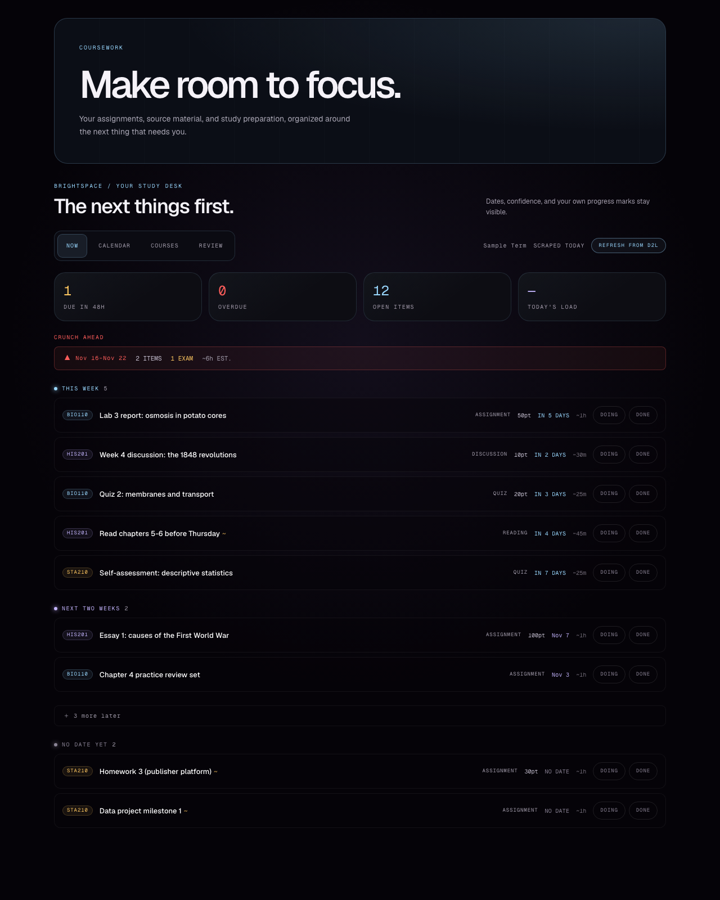
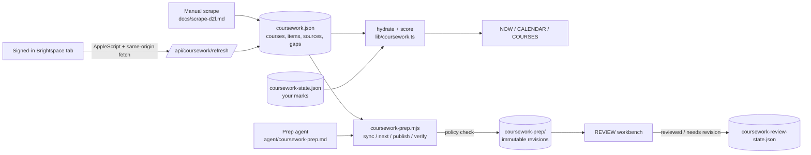

# Coursework Study Agent

A local web app for college students on Brightspace (D2L): it turns every assignment, quiz, discussion and exam into one ranked queue, and pairs it with a study-prep agent that is never allowed to submit work for you.



## Why

Brightspace spreads a semester across course shells, dropboxes, quiz lists, discussion forums, gradebooks and syllabus PDFs. Instructors also copy shells forward without rolling the dates, so last year's deadlines show up as this year's. This app pulls it all into one place, tells you what to touch next, and is honest about which dates it can't vouch for.

The prep side is built around a rule: **an agent can help you study, but it does not do graded work for you.** The policy is written into code and enforced at publish time, not left to a prompt.

## Features

- **NOW view.** One priority score per item combines urgency, grade weight, item type (exams and projects count extra), estimated effort, and date confidence. Items are grouped into Overdue / Today / Tomorrow / This week / Next two weeks / Later / No date yet.
- **Crunch-week warnings.** A week is flagged when it holds an exam, or when its effort is 1.5x the semester's median week and it has 5+ items. The threshold is relative so the warning stays rare.
- **CALENDAR and COURSES views.** Month grid, semester shape, per-course boards and a list of coverage gaps.
- **Date provenance on every item.** Each due date records where it came from (D2L due date, availability end, topic end, syllabus, inferred) plus a confidence level. A date that falls outside the enrollment window is thrown out and the item is shown undated.
- **Your marks stay separate from the scrape.** Status, notes and effort estimates live in `coursework-state.json` and are merged when the data is read. A re-scrape never wipes them because item ids are stable.
- **Live refresh from a signed-in browser tab (macOS).** One button runs a same-origin script in your open Brightspace tab through AppleScript and pulls enrollments, dropboxes, quizzes, discussion topics, the gradebook and content. Your password is never involved.
- **REVIEW workbench.** For each item, the source material is on the left and the prepared work is on the right, with revision numbers, uncertainties, and Mark reviewed / Needs revision / Copy actions.
- **Policy-gated prep agent.** `scripts/coursework-prep.mjs` is the only way an agent can publish prep. It decides what kind of help an item may get and refuses anything else:

  | Situation (detected from the captured source) | Allowed prep |
  | --- | --- |
  | Instructions restrict AI or say "do your own work" | Study guide only |
  | Quiz, exam, time limit, or a single attempt | Quiz prep only (the agent never opens or answers the attempt) |
  | Linked to points or the gradebook | Outline / research notes, not a submission-ready answer |
  | Explicitly labelled practice/review with no grading evidence | Answer draft, held for your review |
  | Anything else | Study guide (the default when it can't tell) |

  Every artifact is an immutable revision with its source snapshot and the notice "Nothing was entered or submitted." The agent instructions (`agent/coursework-prep.md`) also ban making up questions, rubrics, facts, citations or deadlines. When the source is missing it has to block or ask office-hours questions.
- **Expiry.** `npm run expire` marks unfinished work as `expired` once its due day has fully ended. If the scrape is over a week old it waits an extra 7 days. Expiry can be undone and never marks anything done.

## How it works



- `lib/coursework.ts`: pure ranking, bucketing, crunch detection and needed-average math, shared by the API and the UI.
- `lib/courseworkPrep.ts`: prep types and the policy function.
- `lib/server/courseworkRefresh.ts`: D2L normalization: stable ids, term-window date checks, gradebook-only rows, source snapshots, and merging syllabus-derived items.
- `scripts/coursework-prep.mjs`: the agent's only write path. It keeps a fingerprinted manifest, so a ready artifact turns `stale` when its source changes.

## Tech stack

Next.js 15 (App Router, route handlers), React 19, TypeScript, Tailwind CSS 4, plain Node scripts, and `node:test`. All data is local JSON files with atomic writes. There is no database and no cloud service.

## Getting started

Requires Node 22.18+ (the tests import TypeScript directly through Node's type stripping).

```bash
npm install
npm run seed        # copies the fake sample course into ./data, with dates shifted to today
npm run dev         # http://localhost:3000
npm test            # node --test
```

To use your own Brightspace:

```bash
cp .env.example .env.local
# set D2L_BASE_URL=https://yourschool.desire2learn.com
```

| Variable | Purpose |
| --- | --- |
| `D2L_BASE_URL` | Your Brightspace tenant. Required for live refresh. |
| `D2L_LE_VERSION` / `D2L_LP_VERSION` | API versions from `/d2l/api/versions/` (default 1.96 / 1.62). |
| `D2L_TERM_SUFFIX` | Course-code term suffix such as `_FALL_26`. Derived from the date if empty. |
| `D2L_SKIP_TOPICS` | Discussion topics to ignore (default `Questions`). |
| `COURSEWORK_DATA_DIR` | Where data lives (default `./data`, which is git-ignored). |
| `COURSEWORK_PREP_COMMAND` | The command **PREPARE NEXT** runs, e.g. an agent CLI given `agent/coursework-prep.md`. |

Live refresh updates an existing `coursework.json`, so seed first or build one with the manual flow in [`docs/scrape-d2l.md`](docs/scrape-d2l.md). In Chrome, turn on *View → Developer → Allow JavaScript from Apple Events*.

Prep CLI:

```bash
npm run prep -- sync
npm run prep -- next 1
npm run prep -- publish <item-id> payload.json
npm run prep -- block <item-id> missing-source "Prompt not visible in D2L"
npm run prep -- verify
```

## Project structure

```
app/                 Next.js page + API routes (/api/coursework, /prep, /refresh)
components/          Coursework (NOW/CALENDAR/COURSES) and CourseworkReview (REVIEW)
lib/                 Ranking + prep policy (pure); lib/server/ has file I/O and the D2L refresh
scripts/             coursework-prep.mjs (agent write path), expire-coursework.mjs, seed-sample.mjs
agent/               Instructions for the prep agent
docs/                Manual D2L scrape guide, screenshot
data/example/        Fake sample course (the only committed data)
tests/               node:test suites for ranking, policy, prep CLI, expiry, seeding
```

## Status

Extracted from the Coursework tab of my personal dashboard (Omega), where it ran against a real semester. The shell, routing and scheduled runner were removed for this repo: the page here is a small standalone wrapper, and **PREPARE NEXT** runs whatever command you configure instead of Omega's loop engine. All real course data was removed and replaced with an invented sample course. Live refresh is macOS-only and has been used against one Brightspace tenant; other tenants may name course codes or terms differently (see the env variables). Typecheck, `next build`, and 23 tests pass.

Built by [Ian Royes](https://github.com/ianroyes-sys)
